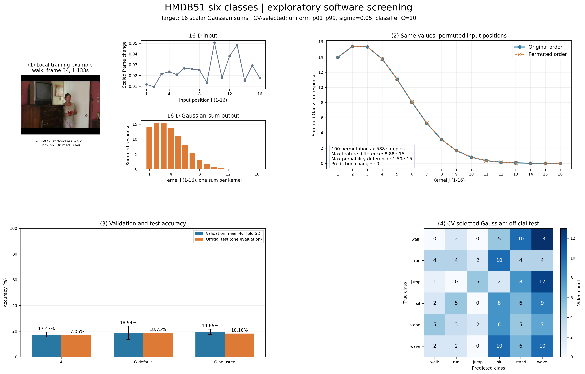

# FYP · HMDB51 六类 Gaussian 求和软件实验

本项目使用真实 HMDB51 视频，研究一个简单问题：**将视频转换为 16 个画面变化量后，固定 Gaussian 映射和核内求和是否能改善动作分类，是否值得继续开展硬件实验。**

当前仅完成软件实验，未操作硬件、未模拟未知器件动态，也未使用 CNN、光流或骨架模型。实验类别为 `walk`（走路）、`run`（跑步）、`jump`（跳跃）、`sit`（坐下）、`stand`（起立）、`wave`（挥手）。

## 最新结果

采用 HMDB51 官方 split 1。六类原有 420 个训练、180 个测试候选；成功读取并满足采样条件的样本为 **412 个训练、176 个测试**，排除原因保存在[排除记录](outputs/hmdb51_software_feasibility_v3/exclusions.csv)。

最新一轮使用相同的固定分层 3 折，仅在官方训练部分选参数，种子为 42，以验证 Macro-F1 均值为主要依据。下表中的三组分类器均独立比较正则化 `C=0.1/1/10`。

| 方案 | 输出维度 | 训练准确率 | 验证准确率（均值 ± SD） | 验证 Macro-F1 | 测试准确率 | 测试 Macro-F1 |
|---|---:|---:|---:|---:|---:|---:|
| A：原始输入 | 16 | 27.43% | 17.47% ± 1.88% | 0.1626 | 17.05% | 0.1538 |
| G 默认 | 16 | 25.97% | 18.94% ± 5.15% | 0.1598 | 18.75% | 0.1604 |
| G 调整 | 16 | 25.49% | 19.66% ± 1.98% | 0.1814 | 18.18% | 0.1752 |

- A 的分类器 `C=0.1`。
- G 默认：16 个中心均匀覆盖 `[0,1]`，`sigma=0.1`，分类器 `C=10`。
- G 调整：16 个中心均匀覆盖训练输入的 P1～P99；完整训练拟合后范围约为 `[0.000290541, 0.250112758]`，`sigma=0.05`，分类器 `C=10`。
- 三组均为 `StandardScaler + LogisticRegression`，`solver=lbfgs`、`max_iter=5000`、`tol=1e-6`。G 默认的 Gaussian 参数未变，但分类器 C 经过同样规则选择，因此其成绩不等于最早的 B（C=1）。

**当前16维输入与所测高斯方案效果不足，暂不支持直接进入硬件实验。** G 调整相对 A 只有小幅改善，相对 G 默认未提高准确率；所选 G 的 30 个 walk 测试样本全部错分。软件候选配置已保存，后续优先检查输入是否混合了动作、背景活动与镜头变化。



结果入口：

- [结果表 CSV](outputs/hmdb51_software_feasibility_v3/results_table.csv) / [高清 PNG](outputs/hmdb51_software_feasibility_v3/results_table.png)
- [简短中文说明](outputs/hmdb51_software_feasibility_v3/简短中文说明.md)
- [完整软件筛选说明](outputs/hmdb51_software_feasibility_v3/软件筛选说明.md)
- [模型核对说明](outputs/hmdb51_software_feasibility_v3/模型核对说明.md)
- [排列不变性检查](outputs/hmdb51_software_feasibility_v3/order_independence_checks.json)
- [逐样本预测与概率](outputs/hmdb51_software_feasibility_v3/sample_predictions.csv)
- [各类指标](outputs/hmdb51_software_feasibility_v3/per_class_metrics.csv)

## 输入表示与数学模型

每段视频取中间固定 1 秒窗口，按实际 FPS 等间隔定位 17 帧。每帧先转灰度、缩放至 `64×64`，再转为 `float32` 并除以 255。相邻两帧的逐像素绝对差取均值，得到 16 维输入：

```text
x_i = mean(abs(frame_(i+1) - frame_i)), i = 1,...,16
```

用相应训练部分所有输入数值的全局最大值统一缩放。验证/测试沿用该缩放参数，并截断超出 `[0,1]` 的值；不按视频或输入位置分别归一化。帧时间会量化到离散帧，实测采样跨度与重复索引见[采样检查](outputs/hmdb51_diagnostics_v2/sampling_span_and_repeated_indices.csv)。

第 j 个核对每个标量输入产生峰值为 1 的 Gaussian 响应，再将该核的全部 16 个响应相加：

```text
R[n,i,j] = exp(-(X[n,i] - mu[j])**2 / (2*sigma**2))
Y[n,j]   = sum_i R[n,i,j]

X: [N,16] -> R: [N,16,16] -> Y: [N,16]
```

每核只输出一个合计值，最终仍为 **16 维**。交换输入位置不会改变这个和；重复输入按出现次数累加，不去重。当前软件中的中心和宽度使用归一化输入坐标，没有擅自赋予脉冲时间或电流单位。

最早的 B 与这个目标定义一致。历史 C 将中间响应按输入位置展开为 256 维，是位置保留的软件诊断；它不满足本轮顺序无关要求，其成绩不用于判断目标模型的硬件可行性。

## 工程结构

| 文件或目录 | 用途 |
|---|---|
| `run_experiment.py` | 视频采样、16维特征缓存、默认 A/B 对比 |
| `download_hmdb51.py` | 官方视频和 split 下载、六类解压辅助脚本 |
| `tune_gaussian.py` | 历史5折参数探索：宽度与中心策略 |
| `diagnose_hmdb51.py` | 实现审计、训练表现、3折选参、历史 A/B/C 诊断 |
| `verify_hmdb51_diagnostics.py` | 独立核对保存的特征、模型预测和指标，不重新拟合 |
| `software_feasibility.py` | 顺序无关目标模型核对、有限选参、缓存复用和汇报图 |
| `requirements.txt` | 经实验使用的固定版本依赖 |
| `outputs/` | 已完成实验的小体积指标、图表、配置、预测及源代码快照 |
| `docs/README_历史实验记录.md` | 本次整理前的完整 README，保留历史说明 |

## 安装

实测环境为 Python 3.10.12、NumPy 1.26.4、OpenCV 4.11.0、scikit-learn 1.7.2。全部实验使用 CPU，无需 GPU。

```bash
git clone https://github.com/Zhi246/FYP.git
cd FYP
python3 -m venv .venv
.venv/bin/python -m pip install --upgrade pip
.venv/bin/python -m pip install -r requirements.txt
```

不要直接依赖系统已有的 OpenCV/NumPy；本项目固定 `numpy==1.26.4` 和兼容的 OpenCV 版本，以避免预装二进制版本冲突。

## 准备数据

原始视频、下载归档和虚拟环境不随 Git 仓库上传。数据来自 [HMDB51 官方页面](https://serre.lab.brown.edu/hmdb51.html)，请按其使用要求获取数据。程序递归寻找类别视频及 split 文件，典型目录为：

```text
data/
├── videos/hmdb51/
│   ├── walk/*.avi
│   ├── run/*.avi
│   ├── jump/*.avi
│   ├── sit/*.avi
│   ├── stand/*.avi
│   └── wave/*.avi
└── splits/
    └── testTrainMulti_7030_splits/
        ├── walk_test_split1.txt
        ├── run_test_split1.txt
        └── ...
```

官方标记 `1` 用于训练，`2` 用于测试，`0` 排除。少于1秒或无法完成解码/采样的视频跳过并记录原因。

若使用官方 RAR 下载辅助脚本，系统需要 `unrar`。也可在 Ubuntu 中将解压工具安装到项目目录而不修改系统：

```bash
mkdir -p data/tools
cd data/tools
apt download unrar
dpkg-deb -x unrar_*.deb .
cd ../..
.venv/bin/python download_hmdb51.py --unrar data/tools/usr/bin/unrar-nonfree
```

历史运行中官方 Google Drive 下载受到访问限制，实际使用官方页面列出的 Hugging Face 镜像获取视频 ZIP 和 split ZIP；来源与实际耗时保存在[下载记录](outputs/hmdb51_six_split1/download_extract_timing.json)。解压后的目录符合上面结构即可；不要用随机数据代替缺失的视频。

## 复现实验

只阅读已提交的结果和图表无需下载数据。首次完整复现需要准备真实数据，并依次生成本地特征缓存、模型和前序验证结果：

```bash
# 1. 原始 A/B：每个视频只提取一次特征
.venv/bin/python run_experiment.py \
  --video-root data/videos --split-root data/splits

# 2. 历史参数探索，生成诊断审计所需的前序结果
.venv/bin/python tune_gaussian.py

# 3. 实现检查与统一3折诊断
.venv/bin/python diagnose_hmdb51.py --stage audit
.venv/bin/python diagnose_hmdb51.py --stage experiment
.venv/bin/python verify_hmdb51_diagnostics.py

# 4. 最新有限软件筛选：另存本地目录，保留已提交的历史报告
.venv/bin/python software_feasibility.py \
  --output outputs/hmdb51_software_feasibility_local
```

这些命令会重建本地缓存与模型，并更新相应前序实验目录。已提交表格是历史实测记录，新运行的路径和耗时可能不同。`run_experiment.py` 支持 `--rebuild-cache`，日常运行优先复用缓存。

如果已经保留本机原实验的全部数据和缓存，可直接运行 `software_feasibility.py`；只有数据、模型、划分、缩放、参数及实现一致时才复用结果。最新一轮实际复用63个折内拟合，未重跑交叉验证，只新增2个最终模型拟合。重复运行会检查签名；条件不一致时应指定新的输出目录。

仅重绘已完成的本地结果：

```bash
.venv/bin/python software_feasibility.py \
  --output outputs/hmdb51_software_feasibility_local --render-only
```

Git 忽略了 `data/`、`.venv/`、Python 缓存、数值特征缓存（`.npz/.npy`）、模型（`.joblib/.pkl`）、重复备份及大体积采样接触图。这些文件保留在本机，可通过以上命令重建。已提交的 `source_code/` 是历史代码快照，用于实现身份核对，请勿将它当作最新执行入口。

## 实验边界

- 测试集已在多轮探索中查看，本项目属于探索性软件筛选，不称为独立最终验证。
- 没有经过验证的同源视频 ID 表；最新比较沿用相同的分层3折，可能有同源/同场景片段跨折。历史5折文件名分组与最新协议分开记录。
- 每折的输入缩放、数据相关中心和 StandardScaler 都只在该折训练部分拟合，正式测试不参与选参。
- 每个目标 G 对全部588个样本各做100次排列检查，特征、概率均在记录容差内一致，预测改变为0；重复值累加检查通过。
- A/G 的差别同时包含 Gaussian 映射与求和，不能全部归因于非线性。历史256维C的差别还涉及位置保留、维度、表达能力和正则化。
- 当前结果仅适用于所选六类、当前输入与所测配置，不代表器件不可行，也不代表所有视频任务或整个 HMDB51 永久不可用。

## 数据集引用

H. Kuehne, H. Jhuang, E. Garrote, T. Serre, and T. Poggio. *HMDB: A large video database for human motion recognition*. ICCV, 2011. 视频数据及其使用要求以原发布方为准。
