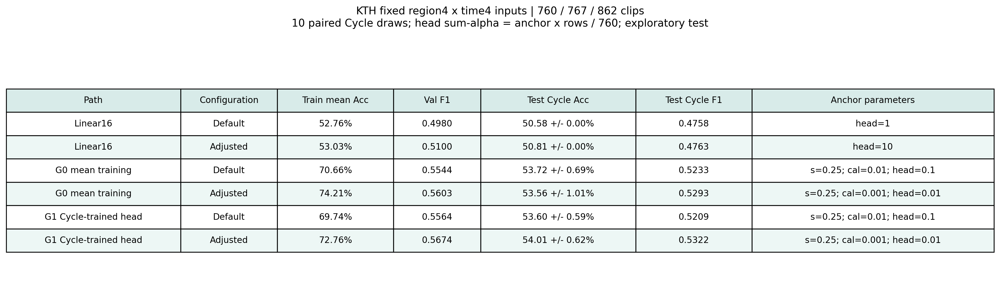
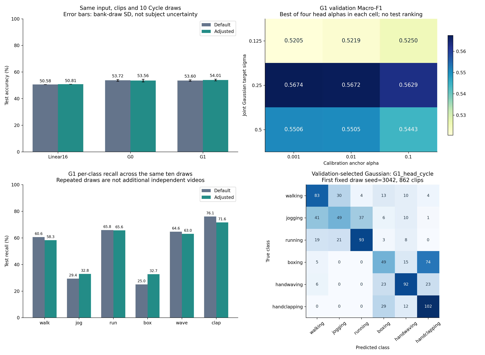

# 器件响应约束下的低维视觉动作特征联合Gaussian编码与稳健识别实验报告

整理日期：2026年10月26日。实验性质：基于真实视频及既有器件响应库的软件可行性验证，未操作硬件。

## 摘要

本研究先在HMDB51六类上检查16维帧差与Gaussian求和，再转向KTH，并按确认的器件软件流程改为响应校准后的256维联合Gaussian。随后分别检验Cycle感知训练、4区域×4时间组输入及有限调参。最新验证预选G1的测试准确率为54.01%、Macro-F1为0.5322，调整后Linear为50.81%／0.4763。Gaussian具有一定软件研究价值，但相对Linear的探索性配对区间包含零，跨人复核未显示调参收益一致。当前不支持直接进入完整硬件实验，下一步应优先检查输入区分度与响应校准的适配。

## 一 研究问题与评价边界

研究方向为“器件响应约束下的低维视觉动作特征联合Gaussian编码与稳健识别”。需要回答：低维视觉输入是否足以区分动作；既定Gaussian编码及校准是否带来收益；面对实测响应变化，这些收益能否保持。

所有实验使用真实视频或其已核验缓存，没有用随机数据代替识别实验。单元测试中的人工数值只用于公式与边界检查。未引入CNN、光流、骨架、人体分割、追踪或自动学习Gaussian参数，也未测量硬件能耗、物理读出时延或在线识别能力。

历史阶段存在两种不同模型：早期16维标量Gaussian求和，以及后来按原器件项目确认的256维联合Gaussian。本报告分别汇报，不能将它们的差额解释为单一因素的效果。更换数据集、分类头、量化或Cycle协议后，也不能把所有分数连接为一次连续受控实验。

## 二 数据与输入

### 数据集及划分

| 数据集 | 六类 | 训练 | 验证 | 测试 | 划分方式 |
|---|---|---:|---|---:|---|
| HMDB51 | walk、run、jump、sit、stand、wave | 412 | 在412段官方训练视频内部3折 | 176 | 官方split 1，不使用标记为0的视频 |
| KTH | walking、jogging、running、boxing、handwaving、handclapping | 760片段 | 767片段 | 862片段 | 官方按参与者划分，8／8／9人 |

HMDB51原候选为420训练、180测试，按实际成功读取数量纳入；无法读取或不足1秒等排除原因保留在样本记录中。早期3折缺少可靠同源分组，不能保证相似来源不跨折。

KTH有599个本地原视频，官方2391个候选动作片段实际纳入2389个，排除一个损坏片段和一个不足1秒片段；另有官方标记缺失的视频，未补造。样本是标注动作子片段，不是完整AVI文件，同一原视频可以贡献多个片段。训练、验证、测试的参与者、源视频及相同内容文件均不重叠。

### 原始时间16维输入

在视频或标注片段中间取固定1秒，根据实际FPS定位17个等间隔采样帧。每帧灰度化、缩放至64×64，先转float32并除以255，再计算相邻帧绝对差的全图均值：

```text
x_i = mean_pixels(abs(frame_(i+1) - frame_i)), i=1,...,16
```

统一缩放使用对应训练部分所有16维数值的全局最大值；零最大值时除数用1。验证和测试沿用训练尺度，越界截断。不逐视频、不逐位置拟合缩放；交叉验证中每折独立拟合预处理。

KTH因离散帧量化，实际跨度为0.96至1.04秒，重复索引数为0。训练示例的独立解码及浮点公式核对通过，不存在uint8相减溢出、NaN或Inf等已发现的实现异常。

### 区域与时间16维输入

后续仅改变视频端编码，沿用完全相同的17帧。将64×64画面固定划为左上、右上、左下、右下四个32×32区域，将16张帧差图分为四组连续的四个间隔：

```text
D_i = abs(frame_(i+1) - frame_i)
x_(r,t) = mean(D_i在区域r内的像素；i属于时间组t)
顺序：左上t1..4、右上t1..4、左下t1..4、右下t1..4，共16维
```

全2389片段重算旧时间输入最大差为0，采样时间戳差为0。新输入12个固定训练示例经独立解码和float64循环核对，最大差约4.32×10⁻⁹，低于1e-7容差。新输入同时保留粗空间分布并降低时间分辨率，不能把效果单独归因为空间信息。固定象限也不等于人体部位。

旧KTH输入训练最大值为0.08867473900318146，新输入为0.1383846402168274。新输入验证集有1/12272个数值被截断，约0.00815%，测试截断为0。分析输入分布时只使用训练数据。

## 三 两种Gaussian模型的区别

### 历史标量求和模型

```text
R[n,i,j] = exp(-(X[n,i]-mu[j])²/(2*sigma²))   # N×16×16
Y[n,j]   = sum_i R[n,i,j]                    # N×16
```

每条曲线处理全部16个输入，重复值按次数累加。交换输入位置不改变最终16维输出，因此它更接近数值分布的软统计表示。A与G均接训练拟合的StandardScaler及多分类逻辑回归，使用相同选参规则。该公式的实现检查通过，但它不等于后来确认的器件软件流程；保留输入位置的旧256维展开诊断也不是下面的联合RBF。

### 当前器件约束联合Gaussian模型

设d为16个有身份的输入坐标，k为16个实测通道，j为256个联合中心：

```text
q = 原项目256实际等级量化(100 × clip(raw16 / train_global_max, 0, 1))
H[n,d,k] = bank(q[n,d], Cycle[n], k)                    # N×16×16
Z[n,d] = [1, (H[n,d,:]-mean[d,:])/std[d,:]]
T[n,d,j] = exp(-(q[n,d]-center[j,d])²/(2*sigma²))
A[d] = Ridge拟合(Z[:,d], T[:,d,:])                     # 每维17×256
F[n,d,j] = clip(Z[n,d] @ A[d], 1e-6, 1)
Phi[n,j] = exp(sum_d(log(F[n,d,j])))                    # N×256
scores = [1,Phi] @ W                                  # one-hot Ridge分类头
prediction = argmax(scores)
```

原始256路响应与最终256维联合特征不是同一对象。每个最终特征对应一个16维中心的联合响应，中间包含逐维校准及跨维因子乘积；不是简单展平或标量求和。

响应库保留实测幅值及符号，不使用理想拟合曲线替换。标准化均值和总体标准差为16×16，标准差下限1e-12；中心和校准只由训练数据拟合，截距不正则化。推理时校准仅读取响应H，不读取原输入q。理想RBF仅作软件诊断。

当前输入坐标有身份，单独打乱输入通常应改变结果；只有连同中心与全部逐维参数共同重编号，才保持同一计算。因此不能继续用早期“仅输入置换不变”作为联合模型检查标准。分类头为Ridge而非Softmax，得分不解释成概率。sigma是软件校准目标宽度，不表示修改物理曲线；本轮未证明这些软件计算全部由器件直接完成。

## 四 实验协议

### 参数选择和防止泄漏

HMDB51在官方训练部分做分层3折；KTH使用官方验证人群选参数。所有缩放、响应标准化、中心、校准与分类头只能用相应训练部分拟合。参数先锁定，再评价测试，不把验证合并进训练重新拟合。

KTH后期另做训练8人内部固定4折按人分组复核，每折重拟合该折预处理和模型。最新有限调参的4折仅复核已锁定参数，不是另一轮网格或测试选择器。主准则为验证Macro-F1，准确率辅助；各轮的并列规则在相应协议文件中保存。

测试集在历史实验中已多次查看，后续输入假设也受到历史错误分析启发。因此这些结果属于探索性软件筛选，不能称为新的独立最终确认。

### Cycle评估边界

最初联合模型使用全部400个Cycle的平均响应训练和评价。后续改为seed=42固定240训练、80验证、80测试索引，三者互斥。均值参照分别平均各自子集，不代表单次读出；主条件为每个片段抽一个Cycle，重复10轮，各方案严格配对。

原响应库约定一个片段所有输入维度和通道共享同一个Cycle。验证seed为2042至2051，测试为3042至3051。额外1%至5%的原模拟器乘性噪声只作次要诊断，不参与选择。

源Excel未在工程内找到，不能独立核对原工作簿的时间顺序和归一化过程。因此Cycle留出是既有处理后响应库的索引隔离，不等于跨器件、跨批次、源归一化之前的原始测量隔离，亦非真实在线硬件验证。

### G0与G1及G2训练方式

| 方案 | 响应标准化与校准 | 分类头 | 独立训练片段／响应行 |
|---|---|---|---:|
| G0 | 训练240 Cycle均值 | 均值特征 | 760／760 |
| G1 | 精确复用G0 | 每片段8个训练Cycle | 760／6080 |
| G2 | 每片段8个训练Cycle | 同一批8个Cycle | 760／6080 |

G1增加的是响应行，不是新视频。为使正则化公平，采用`sum_alpha = anchor_alpha × 实际行数 / 760`，等价平均损失强度为`anchor_alpha / 760`。例如锚定头alpha=0.1时，G0实际alpha=0.1，G1实际alpha=0.8。G2同时改变标准化与校准，不能只归因为校准矩阵。

## 五 分阶段结果

以下准确率均为测试准确率，F1均为Macro-F1。出现±时，除特别说明，均为同一批片段10轮响应库抽样的标准差，不是跨人误差或独立数据集重复。

### 早期HMDB51与KTH标量求和

| 数据与阶段 | A准确率／F1 | 默认G准确率／F1 | 调整G准确率／F1 |
|---|---|---|---|
| HMDB51最新有限筛选 | 17.05%／0.1538 | 18.75%／0.1604 | 18.18%／0.1752 |
| KTH首轮21候选 | 47.91%／0.4680 | 40.26%／0.3864 | 40.37%／0.3880 |
| KTH扩展791候选 | 47.91%／0.4680 | 37.47%／0.3461 | 42.92%／0.4176 |

HMDB51调整G的训练准确率仅25.49%，A为27.43%，不属于训练已分得很好、仅测试差的简单现象。KTH扩展轮比较8种中心布局、14种宽度及7档C，复用21个旧拟合，新增770次。调整G比首轮提高2.55个百分点，但仍低于A。默认G扩大C搜索后验证选到C=0.001，测试反而下降；该负面结果保留，未据测试改回旧参数。

这一阶段表明参数确实会影响统计编码，但没有形成优于保留位置输入的识别表现。Gaussian映射和求和同时变化，不能把差异只归因于非线性，也不能把该结论迁移成当前联合模型必然无效。

### 按原器件流程重新训练

这组为相同KTH时间输入、相同Ridge类型分类头和400 Cycle均值条件，不能与前表的Logistic参照混为一次对照。

| 方案 | 验证准确率 | 测试准确率 | 测试F1 |
|---|---:|---:|---:|
| 标准化Linear16 | 49.80% | 44.90% | 0.4377 |
| 原保存配置的默认联合G | 49.41% | 47.68% | 0.4728 |
| 默认G，仅选择分类头 | 53.85% | 50.12% | 0.4913 |
| 严格联合G调整 | 57.50% | 52.67% | 0.5216 |

严格调整配置为sigma=0.25、校准alpha=0.01、头alpha=0.1、因子裁剪[1e-6,1]。默认为sigma=0.25、校准alpha=1、头alpha=1e-8。收益涉及校准与分类头配合，不能说单调宽度有效。657个完整候选还包括裁剪上界1.2的扩展诊断，其55.45%不作为严格标准成绩。

冻结严格调整模型后，随机Cycle准确率为49.54% ± 0.95%，附加模拟器噪声为49.22% ± 0.86%。均值条件下的52.67%不能直接视为单次器件读出效果。

### 留出Cycle及感知训练

| 时间16维输入方案 | 测试均值准确率 | 测试单Cycle准确率 | 单Cycle F1 |
|---|---:|---:|---:|
| Linear16 | 44.90% | 44.90% | 0.4377 |
| G0 | 52.55% | 49.34% ± 0.57% | 0.4803 |
| G1，验证预选 | 52.09% | 50.75% ± 1.04% | 0.4961 |
| G2 | 48.84% | 49.16% ± 0.43% | 0.4782 |

G1比G0提高1.42个百分点，均值到单Cycle的下降从3.21缩至1.33个百分点，但抽样标准差变大。其配对探索性95%区间为−0.22至+3.30个百分点，包含零。G2单Cycle重建误差较低但识别未更好，说明校准误差与分类目标并不等价。

### 新旧16维视觉编码对照

| 方案 | 原时间输入单Cycle准确率 | 区域与时间输入单Cycle准确率 | 新输入F1 |
|---|---:|---:|---:|
| Linear | 44.90% | 50.58% | 0.4758 |
| G0 | 49.34% ± 0.57% | 53.72% ± 0.69% | 0.5233 |
| G1 | 50.75% ± 1.04% | 53.60% ± 0.59% | 0.5209 |

样本、17帧位置、Cycle分配及后端规则相同，旧模型条件一致直接复用；新表示的缩放、中心和模型由新训练特征重新拟合。G1提高2.84个百分点，但Linear提高5.68个百分点，改善不是Gaussian独有。原先希望减少拳击与拍手混淆的假设没有得到支持：G1拳击→拍手反而由47.62%升至58.81%。

### 固定新输入的最新有限调参

固定256个训练中心，宽度比较0.125／0.25／0.5，校准锚定alpha比较0.001／0.01／0.1，Linear和Gaussian头均比较0.01／0.1／1／10。完成72个Gaussian、4个Linear及12个理想软件诊断候选。4个默认头及默认校准直接复用。

| 方案 | 训练均值准确率 | 验证Cycle F1 | 测试单Cycle准确率 | 测试F1 |
|---|---:|---:|---:|---:|
| Linear默认 | 52.76% | 0.4980 | 50.58% | 0.4758 |
| Linear调整 | 53.03% | 0.5100 | 50.81% | 0.4763 |
| G0默认 | 70.66% | 0.5544 | 53.72% ± 0.69% | 0.5233 |
| G0调整 | 74.21% | 0.5603 | 53.56% ± 1.01% | 0.5293 |
| G1默认 | 69.74% | 0.5564 | 53.60% ± 0.59% | 0.5209 |
| G1调整，验证预选 | 72.76% | **0.5674** | **54.01% ± 0.62%** | **0.5322** |

本表默认指上一轮新输入的固定参数，不是最初保存模型。G0和G1都选sigma=0.25、校准alpha=0.001、头锚定alpha=0.01；G1实际6080行头alpha=0.08。Linear选头alpha=10。

G1仅提高0.42个百分点、F1增加0.0113；G0准确率反而略降而F1增加。G1相对调后Linear高3.20个百分点，但配对探索性95%区间为−1.31至+7.45个百分点；G1调整减默认为−0.96至+1.69个百分点，均包含零，尚不能认定稳定优势。



图1：相同新16维输入与Cycle抽样下的主结果。参数中的head为锚定alpha，实际求和形式需按拟合行数换算。

## 六 参数影响与错误分析

### 验证收益主要与分类头正则化有关

G1默认验证F1为0.556431，只将头alpha由0.1改为0.01可到0.567159；再将校准alpha由0.01降至0.001为0.567446。只改校准而保留默认头为0.555226。单改宽度到0.125或0.5则为0.521859或0.544017。

因此，本轮没有发现改宽度优于原0.25；验证收益主要与分类头正则化相关。该消融只基于已有验证记录，不能精确分解测试收益，也不代表已找到全局最优。选中头和校准参数位于所测下边界，没有继续自动扩搜。

新输入联合特征相对同配置理想特征的测试单Cycle误差约15.76%至15.77%，调整前后几乎不变，不能把识别提升说成重建误差大幅降低。独立选择的理想软件RBF达到61.14%，但使用另一宽度0.5，不是硬件成绩或保证上界，其与54.01%的全部差距也不能都归因于校准。

### 类别改善存在权衡

| G1新输入召回率 | 调参前 | 调参后 |
|---|---:|---:|
| 走路 | 60.63% | 58.26% |
| 慢跑 | 29.38% | 32.85% |
| 跑步 | 65.83% | 65.63% |
| 拳击 | 25.03% | 32.73% |
| 挥手 | 64.58% | 62.99% |
| 拍手 | 76.08% | 71.61% |

拳击→拍手由841/1430次降至751/1430次，即58.81%降至52.52%；1430次来自同一143个片段各10轮响应，不是1430个独立视频。拳击和慢跑改善，但拍手、走路和挥手退化。d2场景准确率仍仅33.06%，跨人及场景差异仍值得检查；人物尺度、位置和背景影响目前只是可能原因。

### 跨人复核不支持稳定调参收益

| 新输入方案 | 调参前训练人群4折准确率 | 调参后4折准确率 |
|---|---:|---:|
| Linear | 49.55% ± 5.68% | 49.81% ± 5.84% |
| G0 | 55.79% ± 4.49% | 54.70% ± 4.11% |
| G1 | 56.05% ± 3.85% | 55.67% ± 4.05% |

此处±为折间标准差，与响应库抽样标准差不同。G1在官方验证和测试均值上小幅改善，但4折未同步改善；不能根据这张表或测试反过来挑选正式配置。



图2：左上为准确率，右上仅为验证参数热图，左下为类别召回率，右下为验证预选G1在固定首轮seed=3042的混淆矩阵，纵轴真实、横轴预测。首轮862片段矩阵不是10轮平均，也不是挑选最好的一轮。

## 七 实现核对与运行成本

样本、标签、划分和特征逐项核对，训练测试无参与者或源视频重叠；独立采样与浮点帧差、Gaussian公式和输出维度、训练限定统计、重复值及历史置换检查均有记录。当前联合模型另核对独立因子乘积、协调维度重编号及Ridge正规方程。最新8个模型全部逐样本得分与类别可重载复现，atol与rtol均为1e-11；25项单元测试通过。

没有发现需要更正当前输入或联合计算的实现错误。历史求和公式实现正确，不表示它符合后来确认的器件模型；模型定义更新与代码数值错误应分开。

| 阶段 | 实测墙钟 | 说明 |
|---|---:|---|
| KTH首次下载校验与解压 | 655.49秒 | 历史一次性成本，后续未重新下载 |
| KTH初始视频采样预处理 | 14.86秒 | 逐视频流式读取 |
| 原联合模型657候选及首轮处理 | 23.43秒 | 参数搜索16.21秒；严格筛选另4.38秒、无新训练 |
| Cycle感知训练主流程 | 15.90秒 | 含校验、评价与重载，不含绘图 |
| 新时空输入提取 | 18.96秒 | 含源视频哈希及旧特征重算核对 |
| 新输入模型阶段 | 14.20秒 | 旧输入模型复用，不含另行绘图 |
| 最新88候选有限调参主流程 | 20.20秒 | 含搜索、4折、评价及重载；绘图另计 |

各行是不同阶段边界，不将并行下载任务或缓存复用时间重复相加。环境为Intel Core i7-14700KF，后期Torch及BLAS限制1线程，无GPU。最新主进程峰值RSS约727.6 MiB，新输入模型阶段约767.6 MiB；它们是不同进程的测量值，不能相加。

KTH原视频1,162,375,168字节、总时长11,591.24秒、容器元数据289,781帧。单套2389×16 float64输入为305,792字节；6080×256 float32训练响应为6,225,920字节；单个862×256联合特征矩阵为882,688字节。存储量不等于峰值内存，没有把全部原始帧一次载入内存。

## 八 当前结论与后续研究

当前保留的**软件候选**为区域与时间16维输入、固定256个训练中心、sigma=0.25、校准alpha=0.001、G1分类头锚定alpha=0.01（6080行实际0.08）。同时保留默认G1、调后G0和alpha=10的Linear参照，不将探索性小幅收益包装成可部署方案。

已验证的是：输入表示、中心范围及正则化会影响分类；当前联合Gaussian在部分协议下平均优于对应Linear；响应变化和跨人差异会改变排名。尚未验证的是：这种优势能否稳定迁移到独立人群、原始测量隔离、其他器件和真实在线硬件。

下一步优先在训练／验证部分检查拳击与拍手、慢跑与走路的输入重叠，以及按类别、人物分解的校准误差，再决定是否单独修改输入。不要同时改变采样、视觉特征和模型，也不要仅为提高已查看测试分数继续扩网格。新的确认性结论需要预先固定协议及明确的独立评估安排。

当前16维输入与所测高斯方案的识别水平和稳定性仍不足，暂不支持直接进入完整硬件实验。这一结论不表示整个HMDB51、KTH、所有动作任务或Gaussian器件永久不可用。Gaussian相对Linear的差异包含联合映射、特征维度扩展及校准误差，不能全部归因于Gaussian非线性；研究不预设它必须胜过Linear。

## 九 复现与材料索引

本报告直接核对并汇总7份已完成CSV中的30行结果，没有重新训练或评价测试。精确数值及源CSV哈希见[机器可读汇总CSV](assets/experiment_summary.csv)与[JSON](assets/experiment_summary.json)，可运行：

```bash
python scripts/build_experiment_report_summary.py
```

各阶段完整协议、命令和结果入口如下。

| 阶段 | 说明与结果 |
|---|---|
| 历史HMDB51和KTH求和 | [阶段记录](视频动作识别_数据研究方向与实验结果.md)、[HMDB51结果](../outputs/hmdb51_software_feasibility_v3/results_table.csv)、[KTH首轮](../outputs/kth_six_subject_split_v1/results_table.csv)、[KTH扩展](../outputs/kth_gaussian_expanded_v2/comparison_previous_vs_expanded.csv) |
| 原器件联合流程 | [说明](KTH_原器件流程训练与研究方向.md)、[严格结果](../outputs/kth_joint_rbf256_strict_v1/results_table.csv) |
| Cycle稳健训练 | [说明](KTH_Cycle感知稳健训练结果.md)、[结果](../outputs/kth_cycle_robustness_v1/results_table.csv) |
| 时空输入对照 | [说明](KTH_16维时空输入对照结果.md)、[结果](../outputs/kth_spatiotemporal_v1/results_table.csv)、[真实训练帧示例](../outputs/kth_spatiotemporal_v1/figures/input_example_with_real_frame.png) |
| 最新有限调参 | [说明](KTH_固定时空输入Gaussian有限调参结果.md)、[结果](../outputs/kth_spatiotemporal_tuning_v1/results_table.csv)、[验证候选](../outputs/kth_spatiotemporal_tuning_v1/validation_candidates.csv)、[参数](../outputs/kth_spatiotemporal_tuning_v1/final_parameters.json)、[核对](../outputs/kth_spatiotemporal_tuning_v1/verification.json)、[命令](../outputs/kth_spatiotemporal_tuning_v1/run_command.txt) |

GitHub发布包含代码、报告、图表、汇总指标、划分及检查记录；原视频、二进制特征／响应缓存、模型和大型逐样本得分CSV保留本地，不随仓库上传。历史细节文档中指向这些本地材料的链接需要完整本地工程才能打开。

当前器件脚本依赖独立原项目`/home/ziyan/SURF2026/rbf_hardware`中的原始接口及响应库；视频读取与Torch训练使用两个现有环境。仓库不包含完整响应库，新的机器需要提供相应数据和原项目并调整路径，不能仅克隆仓库就声称可直接复现。依赖与各轮命令见[README](../README.md)及[requirements_joint.txt](../requirements_joint.txt)。
