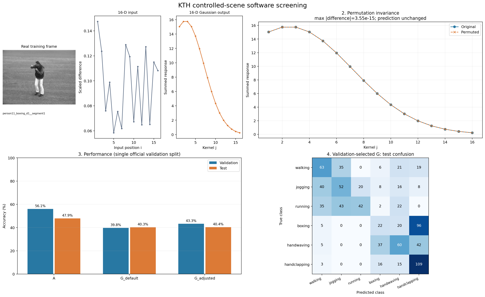
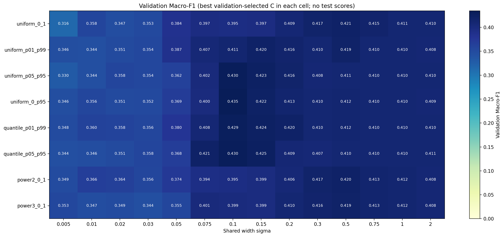

# 视觉动作识别数据研究方向与实验结果

整理日期：2026年10月25日；更新日期：2026年10月26日。阶段：软件可行性验证，尚未进行硬件实验。

综合阅读入口：[器件约束视觉动作识别实验报告](器件约束视觉动作识别_实验报告.md)。报告以KTH为主体，按选择原因、研究方向、实验流程和对应结果编排；本文保留KTH阶段记录。

## 数据选择与原因

前期HMDB51在当前低维表示下效果不理想，因此转用KTH做更受控的软件验证。

KTH具有较统一的背景、固定相机、六类动作和官方按人划分的训练／验证／测试协议，适合先检查轻量帧差输入和Gaussian编码，再分析跨人变化。[KTH官方说明](https://www.csc.kth.se/cvap/actions/)、[官方划分](https://www.csc.kth.se/cvap/actions/00sequences.txt)。这是本项目的实验设计选择，不保证Gaussian一定更好，也不把更换数据集的全部分数变化归因于背景简化。

实际使用599个原视频中的2389个成功标注片段，按官方参与者分为760训练、767验证、862测试；同一人和同一源视频不跨集合。

## 当前研究方向与实验流程

研究方向：**器件响应约束下的低维视觉动作特征联合Gaussian编码与稳健识别**。核心是紧凑视觉输入、响应约束下的联合编码和识别稳健性，不是预设Gaussian必须胜过Linear。

统一流程为“官方片段→中间1秒17帧→16维运动量→训练尺度缩放及量化→Linear或器件响应校准后的256维联合Gaussian→验证选参→锁定后测试”。只做软件，不操作硬件。

| 实验环节 | 固定条件与改动 | 对应已完成结果 |
|---|---|---|
| 模型核对 | 时间16维输入，按原器件流程校准并联合重建 | 400 Cycle均值条件下，严格调整G为52.67%，同组Linear为44.90% |
| 响应稳健性 | 固定输入和公式，留出Cycle并比较G0／G1／G2 | 时间输入下G1单Cycle为50.75%，G0为49.34% |
| 输入对照 | 固定后端与Cycle分配，只改为4区域×4时间组 | G1为53.60%，同组Linear为50.58% |
| 有限调参 | 固定新输入及中心，比较宽度和正则化 | G1为54.01%，同组调后Linear为50.81% |

上表各行属于不同协议，不应作为一次同条件的连续涨分；下面保存各轮详细结果与限制。

## 最新结果 固定新输入的Gaussian有限调参已完成

固定“4区域×4时间组”的16维输入、256个训练中心和原器件计算，完成72个Gaussian、4个Linear及12个理想软件参考候选。宽度比较0.125／0.25／0.5，校准alpha比较0.001／0.01／0.1，所有分类头按相同规则比较0.01／0.1／1／10。先验证锁定配置，后评价测试；没有下载、重采样或操作硬件，旧结果保留。

| 方案 | 调整前测试Cycle准确率 | 调整后 | 调整后Macro-F1 |
|---|---:|---:|---:|
| Linear16 | 50.58% | 50.81% | 0.4763 |
| G0 | 53.72% ± 0.69% | 53.56% ± 1.01% | 0.5293 |
| G1，验证预选 | 53.60% ± 0.59% | **54.01% ± 0.62%** | **0.5322** |

±为同一862片段10轮Cycle抽样的标准差。验证仍选sigma=0.25，校准alpha=0.001，头锚定alpha=0.01；G1的6080行实际头alpha=0.08。Linear选头alpha=10。验证消融提示改善主要与头部正则化有关，不能宣称调宽度有效；G1仅提高0.42个百分点，探索性配对区间包含0，训练人群4折也未改善。

拳击→拍手错误率从58.81%降至52.52%，但拍手、走路和挥手召回率下降。理想软件参考为61.14%，使用另一宽度0.5，不是器件成绩。**调后G1保留为软件候选，但尚不支持稳定Gaussian优势或直接进入完整硬件实验；下一步优先检查输入的类别区分度、跨人差异与校准适配，而非继续追逐已查看测试集的最高分。**

25项测试和全部最终预测重载核对通过；主流程20.20秒、CPU单线程、无GPU、峰值RSS约727.6 MiB。详见[完整报告](KTH_固定时空输入Gaussian有限调参结果.md)、[结果表](../outputs/kth_spatiotemporal_tuning_v1/results_table.png)、[组会四联图](../outputs/kth_spatiotemporal_tuning_v1/four_panel_summary.png)。独立结果目录为`outputs/kth_spatiotemporal_tuning_v1/`；原响应库Excel缺失和探索性筛选的限制仍保留。

## 上一轮结果 16维时空输入对照已完成

已完成“4个固定画面区域×4个时间组”的16维输入，后端仍为原器件响应库、标准化、Ridge校准、跨维乘积联合Gaussian256与Ridge分类。相同599个视频、2389片段、17帧采样位置及Cycle划分；新输入独立缓存，旧输入模型和成绩复用。没有新增下载或操作硬件。

| 方案 | 旧输入Cycle准确率 | 新输入Cycle准确率 | 新输入Macro-F1均值 |
|---|---:|---:|---:|
| Linear16 | 44.90% | 50.58% | 0.4758 |
| G0 均值训练 | 49.34% ± 0.57% | 53.72% ± 0.69% | 0.5233 |
| G1 分类头Cycle训练，验证预选 | 50.75% ± 1.04% | **53.60% ± 0.59%** | **0.5209** |

±为同一862片段10轮响应库抽样的标准差。验证在测试前选定“新输入＋G1”，不能因G0测试略高而改选。G1比旧输入平均提高2.84个百分点，但Linear也提高5.68个百分点；新G1相对新Linear的3.02个百分点差异，探索性配对区间仍包含0，不能认定Gaussian已有稳定优势。

新输入的G1在训练人群内部4折准确率为56.05% ± 3.85%，旧输入为48.04% ± 6.38%，这里±是折间标准差。理想软件RBF达到59.51%，不是器件成绩；拳击→拍手错误反而由47.62%升到58.81%，整体提高不等于所有动作都改善。

**当前保留新输入＋G1为软件候选，继续保留新G0与Linear对照；下一轮固定输入，有限检查Gaussian校准适配及拳击类退化，不直接进入完整硬件实验。** 本轮同时改变空间保留与时间汇总，不能将提升单独归因于空间或Gaussian非线性。源Excel缺失，仍是既有归一化响应库的索引留出实验。

全部旧16维特征重算最大差0；12个训练片段的新编码独立核对最大差约4.32×10⁻⁹。提取18.96秒、模型阶段14.20秒，无GPU，模型进程峰值RSS约767.6 MiB。详见[完整说明](KTH_16维时空输入对照结果.md)、[结果表](../outputs/kth_spatiotemporal_v1/results_table.png)、[四联图](../outputs/kth_spatiotemporal_v1/four_panel_summary.png)。新结果目录为`outputs/kth_spatiotemporal_v1/`。

## 上一轮结果 Cycle感知稳健训练

研究方向确定为：**器件响应约束下的低维视觉动作特征联合Gaussian编码与稳健识别**。已完成G0／G1／G2训练，保持原16维输入、目标sigma=0.25、256维联合Gaussian和因子裁剪[1e-6,1]不变，未改视频预处理、未下载新数据、未操作硬件。

响应库按seed=42固定240个训练、80个验证、80个测试Cycle索引；一段视频的全部维度共享一个Cycle索引。视频仍是760／767／862个官方划分片段。G1与G2每段用8个训练Cycle，增加的是响应训练行，不是新视频；正则化按平均损失保持公平。

| 方案 | 测试均值响应准确率 | 测试单次Cycle准确率 | Cycle Macro-F1均值 |
|---|---:|---:|---:|
| G0 均值训练 | 52.55% | 49.34% ± 0.57% | 0.4803 |
| G1 只让分类头适配Cycle | 52.09% | **50.75% ± 1.04%** | **0.4961** |
| G2 校准与分类头共同适配 | 48.84% | 49.16% ± 0.43% | 0.4782 |

G1在测试前已由验证Macro-F1选定。其Cycle准确率比G0提高1.42个百分点，均值到单次Cycle的下降由3.21缩小到1.33个百分点；但测试抽样标准差变大，按人及抽样轮次配对的探索性95%区间为−0.22至+3.30个百分点，包含0，不能认定稳定优势。±表示同一862片段10轮响应抽样的标准差，不是跨人误差。

训练8人内部4折复核中，G0／G1／G2准确率均值分别为47.00%／48.04%／50.20%，排名与官方验证不一致。G2虽降低单次Cycle下的重建误差，却未改善官方测试，表明重建误差与识别率不能混为一谈。

**下一轮保留G1为软件候选，单独检验“4个空间区域×4个时间段”的16维视觉编码，继续保留G0对照，暂不直接进入完整硬件实验。** 原Excel未在工程内找到，本轮仅是既有处理后响应库的索引留出，不能称为跨器件、跨批次或原始测量全链路独立验证。旧52.67%与49.54%的实验使用全部400个Cycle均值及不同抽样条件，不能直接替代本轮参照。

详见[Cycle稳健训练完整说明](KTH_Cycle感知稳健训练结果.md)、[结果表](../outputs/kth_cycle_robustness_v1/results_table.png)、[四联图](../outputs/kth_cycle_robustness_v1/four_panel_summary.png)。主流程15.90秒，画图分析约1.79秒，CPU单线程、未用GPU，主进程峰值RSS约755.1 MiB；原结果与原器件项目保留。

## 上一轮结果 原器件项目的联合Gaussian参数筛选

核对原项目后，当前标准已明确为：**16维输入→实测16×16响应→逐维逐通道标准化→Ridge校准→跨维乘积重建→256维联合Gaussian→Ridge分类**。这不是下面历史实验的16维Gaussian求和；输入维度有身份，不能再把“乱序不变”作为当前目标。

已在同一KTH缓存上完成新训练和验证选择，使用760训练、767验证、862测试动作片段，没有重新下载或修改视频预处理。严格保持截图中的因子裁剪[1e-6,1]，结果如下：

| 方案 | 验证准确率 | 测试准确率 | 测试Macro-F1 |
|---|---:|---:|---:|
| 本轮Linear16并训练标准化，Ridge头 | 49.80% | 44.90% | 0.4377 |
| 原保存配置的默认联合G | 49.41% | 47.68% | 0.4728 |
| 默认联合G，仅选择分类头正则化 | 53.85% | 50.12% | 0.4913 |
| 调整联合G，严格裁剪上界1 | 57.50% | **52.67%** | **0.5216** |

调整配置为256个训练KMeans中心、目标sigma=0.25、校准alpha=0.01、分类头alpha=0.1、seed=42。相对本轮Linear准确率提高7.77个百分点，相对默认G提高4.99个百分点。只搜索宽度没有选出优于默认宽度的配置，不能将全部改善解释成“调宽度有效”。另有裁剪上界扩至1.2的55.45%分支，仅作扩展软件诊断，不作为严格标准成绩。

**当前推荐方向：器件响应约束下的低维视觉动作特征联合Gaussian编码与稳健识别。** 值得继续软件研究，但不建议仅凭均值响应下的52.67%直接进入完整硬件实验：冻结模型后Cycle抽样平均49.54%，加入原模拟器噪声为49.22%，拳击与拍手仍明显混淆。下一步先做输入不变的Cycle感知稳健校准，再单独比较仍为16维的空间与时间运动编码。

详见[原器件流程训练结果与研究方向](KTH_原器件流程训练与研究方向.md)、[正式结果表](../outputs/kth_joint_rbf256_strict_v1/group_meeting_table.png)、[新四联图](../outputs/kth_joint_rbf256_strict_v1/group_meeting_four_panel.png)。新结果目录为`outputs/kth_joint_rbf256_strict_v1/`；657个候选拟合均保留，严格标准筛选没有重复训练。本轮仍是探索性筛选，不是新的独立最终验证。

## 以下保留旧版求和分支的历史记录

下文的模型、顺序无关检查、成绩和后续建议均属于旧标量Gaussian求和分支，用于复查历史过程；不再作为当前器件模型定义或当前可行性结论。旧A使用逻辑回归，本轮A使用原项目Ridge分类头与量化输入，两者分数不能当作同一次控制实验。

## 历史求和分支阶段结论

本阶段希望判断：视频经过轻量预处理得到16个输入后，与目标核内电流叠加一致的Gaussian求和计算，能否提供有用的分类特征，并值得进一步开展硬件实验。

KTH原始输入参照A达到47.91%，首轮默认G和调整G分别为40.26%和40.37%。10月26日扩大到791个配置后，验证选出的G提高到42.92%、Macro-F1为0.4176，相对首轮调整G提高2.55个百分点，但仍低于A。中心和宽度会影响结果，当前改善尚未形成相对原始输入的优势。

**当前16维输入与所测高斯方案效果不足，暂不支持直接进入硬件实验。下一阶段保留KTH，优先研究输入表示与统计汇总的适配，不再只扩大Gaussian参数搜索。** 这一判断针对当前历史方案，不代表KTH或Gaussian器件普遍不可用。

## 一 数据集与实验划分

### KTH六类受控场景实验

采用walking、jogging、running、boxing、handwaving、handclapping，分别对应走路、慢跑、跑步、拳击、挥手、拍手。KTH使用较统一的背景和固定相机，更便于检查当前输入是否能够表达动作差异。[KTH官方数据说明](https://www.csc.kth.se/cvap/actions/)

本地原始数据为599个视频文件，官方标注给出2391个动作子片段，另有一个明确标记缺失的视频。**实验样本是标注动作片段，不是完整AVI文件；同一视频可以贡献多个片段。** 每个片段独立取中间1秒，避免把长视频中的动作间隔当作中心动作窗口。

采用官方原始参与者划分，不随机混分片段：[官方标注及划分文件](https://www.csc.kth.se/cvap/actions/00sequences.txt)。

| 集合 | 参与者数量 | 纳入动作片段 | 用途 |
|---|---:|---:|---|
| 训练 | 8人 | 760 | 拟合缩放、中心、StandardScaler和分类器 |
| 验证 | 8人 | 767 | 选择Gaussian配置和分类器正则化 |
| 测试 | 9人 | 862 | 参数锁定后的分类评价 |

共纳入2389个片段；排除1个无法完成采样的损坏片段、1个不足1秒的片段。缺失视频未补造样本。同一参与者、同一源视频及相同文件内容均未跨训练、验证、测试集合。最终模型仅用训练8人拟合，没有合并验证集重训。

更换数据集还涉及类别、拍摄来源和片段协议差异，因此不能把分数变化直接解释为“去除复杂背景的效果”。

## 二 研究方向与计算模型

### 研究定位

拟议方向为：**面向轻量视觉动作识别的顺序无关Gaussian统计编码研究。** 重点不是预设Gaussian能够提高准确率，而是验证它在信息压缩、统计编码或扰动条件下，是否具有值得硬件实现的实际价值。

需要回答三个问题：

1. 当前16个输入是否包含足够的动作信息，还是主要反映画面整体变化幅度？
2. Gaussian映射与求和是否形成有用的统计表示，相比原始输入或普通直方图是否有收益？
3. 如果软件中存在可重复的收益，计入视觉预处理成本后，是否仍值得映射到硬件？

### 已完成实验的输入定义

KTH时间16维输入将采样范围限定在官方标注片段内。

1. 取中间固定1秒，按实际FPS等间隔定位17帧。
2. 每帧转灰度、缩放为64×64，再转float32并除以255。
3. 对每对相邻采样帧计算绝对差，再取全部像素的均值，得到16个输入。

```text
x_i = mean(abs(frame_(i+1) - frame_i)), i = 1,...,16
```

统一除以相应训练部分全部输入的全局最大值；验证和测试沿用该尺度，超出[0,1]时截断。最大值为零时用1作为除数。不逐视频归一化，也不按16个位置分别缩放。KTH本轮验证和测试截断率均为0。

### Gaussian目标模型

一个输入在第j个核内产生峰值为1的Gaussian响应，核内将全部16个输入的响应相加，每核输出1个合计值。

```text
R[n,i,j] = exp(-(X[n,i] - mu[j])**2 / (2*sigma**2))
Y[n,j]   = sum_i R[n,i,j]

输入 X：N×16
中间响应 R：N×16×16
最终输出 Y：N×16
```

交换输入排列不改变这个和；重复数值按出现次数累加，不能去重。中心和宽度固定，不通过神经网络学习。当前参数单位是归一化后的输入坐标，不擅自解释成未知器件的真实脉冲时间或电流单位。

| 方案 | 分类器接收的特征 | 维度 | 定位 |
|---|---|---:|---|
| A | 缩放后的原始帧差序列 | 16 | 输入表示参照，保留位置 |
| G默认 | 默认Gaussian响应的核内求和 | 16 | 目标计算方式，默认中心和宽度 |
| G调整 | 相同求和公式，经验证选择中心与宽度 | 16 | 目标计算方式的有限调参 |

三组均使用仅在各自训练特征上拟合的StandardScaler，再接多分类逻辑回归。统一采用L2正则化、lbfgs求解器、max_iter=5000、tol=1e-6、seed=42；首轮分类器C均比较0.1、1、10，KTH扩展轮均扩大到0.001、0.01、0.1、1、10、100、1000。

历史256维C方案保留每个输入位置的Gaussian响应，不满足目标模型的顺序无关要求，不能将其分数当作当前硬件模型的可行性证据。

## 三 已完成实验结果

### KTH首轮结果

中心只比较默认均匀[0,1]和训练输入P1至P99均匀布局；统一sigma比较0.05、0.1、0.2。加上各组分类器C，共完成21个候选拟合，均正常收敛。以官方验证集Macro-F1选配置、准确率辅助，锁定后再评价测试。

| 方案 | 训练准确率 | 验证准确率 | 验证Macro-F1 | 测试准确率 | 测试Macro-F1 |
|---|---:|---:|---:|---:|---:|
| A | 53.82% | 56.06% | 0.5455 | **47.91%** | **0.4680** |
| G默认 | 40.92% | 39.77% | 0.3725 | 40.26% | 0.3864 |
| G调整 | 36.58% | 43.29% | 0.4124 | 40.37% | 0.3880 |

KTH采用单次官方验证划分，不是3折结果，因此没有折间均值、标准差或虚构误差线。A训练准确率53.82%、测试47.91%，G调整训练36.58%、测试40.37%；当前主要现象不是“训练几乎满分、测试大幅下降”。

| 方案 | 中心布局 | 统一sigma | 分类器C |
|---|---|---:|---:|
| A | 不适用 | 不适用 | 0.1 |
| G默认 | 16中心均匀覆盖[0,1] | 0.1 | 0.1 |
| G调整 | 16中心均匀覆盖[0.0317144463, 0.6815130554] | 0.2 | 0.1 |

G调整的区间来自训练输入P1至P99。它的验证准确率比默认G提高3.52个百分点，但测试仅从347/862正确增加到348/862正确，提高0.12个百分点；Macro-F1仅提高0.0016。相对A，调整G测试准确率低7.54个百分点，不能称为可靠的编码收益。这套参数仅作为软件候选保留，不是进入硬件的推荐配置。



图1：固定训练样本的真实帧、16维输入与Gaussian输出；随机排列前后输出重合；验证与测试性能对比；按验证预先选定G的测试混淆矩阵。混淆矩阵纵轴是真实类别，横轴是预测类别。

### KTH扩展调参结果

2026年10月26日保持输入、样本和官方参与者划分不变，扩展为8种中心布局、14种统一宽度、7档分类器C，共791个配置（784个G、7个A）。中心包括均匀全范围、训练主要范围、分位数布局和低值区加密布局；sigma覆盖0.005至2。复用21个条件完全一致的旧拟合，新增770次拟合，全部收敛。测试仅评价参数锁定后的方案，没有给791个配置逐一计算测试分数后挑最高者。

| 方案 | 训练准确率 | 验证准确率 | 验证Macro-F1 | 测试准确率 | 测试Macro-F1 |
|---|---:|---:|---:|---:|---:|
| 扩展A | 53.82% | 56.06% | 0.5455 | 47.91% | 0.4680 |
| 默认Gaussian只扩展C搜索 | 35.39% | 41.85% | 0.3946 | 37.47% | 0.3461 |
| 扩展Gaussian搜索 | 40.39% | 45.37% | 0.4346 | 42.92% | 0.4176 |

扩展G选定16个中心均匀覆盖[0,训练缩放输入P95]，实际为[0,0.4782097120]，sigma=0.1、C=0.1。相对首轮调整G，测试从348段正确升到370段正确，提高2.55个百分点，Macro-F1提高0.0296；相对首轮默认G提高2.67个百分点。新G与首轮默认G的sigma、C均为0.1，两者只改变中心布局，提示中心范围确实会影响当前结果。新G仍低于A 4.99个百分点，不能据此认定已适合进入硬件。

默认Gaussian只扩大C搜索后，验证选到C=0.001，验证分数较首轮提高，但测试从40.26%降到37.47%。这是验证与测试排序不一致的实际结果，不能隐藏，也不能根据测试改选C。扩展轮继续属于探索性软件筛选；更大的搜索可能适配单个验证集，不代表更稳定的泛化。



图2：8种中心布局与14种宽度的验证Macro-F1，每个格子在7档C中按验证规则选择，不含其他候选的测试分数。完整对比、实际中心和模型见[扩展调参说明](../outputs/kth_gaussian_expanded_v2/扩展调参说明.md)。

### 主要错误与实现检查

首轮调整G中，拳击143段只有22段正确，其中96段被预测为拍手；跑步144段只有42段正确，其中43段被预测为慢跑。扩展G的拳击正确29段，仍有87段错为拍手；跑步正确44段，50段错为慢跑，类别混淆仍明显。扩展G的9名测试参与者准确率约为32.29%至51.58%，这是同一测试集的按人分解，不是9次独立重复实验。

样本、标签、划分与特征对齐检查通过；不存在NaN、Inf或全零样本。12个固定训练片段经过独立解码及float64手工计算，帧差与缓存最大差异约1.86×10⁻⁹。由于离散帧量化，KTH实际采样跨度为0.96至1.04秒，重复帧索引数为0。

每个G对全部2389个样本各做100次随机排列，最大特征差异约8.88×10⁻¹⁵，预测类别改变0次；重复值累加、独立Gaussian公式和分类器收敛检查通过。解码失败的片段已排除并保留告警记录，没有用随机数据或补造帧代替。

## 四 结果解释与后续研究

### 当前证据支持的解释

全图平均帧差只表示变化量大小，不能直接表达人体位置、姿态或运动方向；Gaussian求和进一步将16个数汇总为一种软直方图式统计表示。将同一组17个采样帧倒序时，16个相邻绝对帧差只是反序，最终Gaussian特征不变，说明该表示无法区分所有方向或顺序相关的动作差异。

KTH中A与G的训练表现都不高，且G低于A，提示需要优先检查输入中是否缺少可分信息，以及统计汇总是否适合当前任务。但A与G的差别同时包含Gaussian映射、位置汇总及相应的模型表达差异，本轮不能单独定位为“Gaussian非线性有问题”或“丢失顺序是唯一原因”。

### 下一轮优先级

| 优先级 | 软件实验 | 要回答的问题 |
|---|---|---|
| 1 | 复用当前KTH特征，增加16分箱普通直方图参照，沿用相同分类器选参规则 | 效果不足是否与把输入汇总成数值分布有关；Gaussian是否优于简单计数 |
| 2 | 固定KTH及Gaussian公式，预先限定一种前景或局部运动输入，与全图帧差单变量对照 | 输入能否更集中地反映人体动作，而非全图整体变化 |
| 3 | 在确定候选后，统一比较采样变化、观测噪声或缺失帧下的表现 | Gaussian统计编码是否存在稳定性价值，而不仅是单次干净数据准确率变化 |

以上是待执行方案，不是已取得的结果。每轮只改一个关键因素，输入提取成本单独统计；保持目标G为16核、16维、固定Gaussian参数与顺序无关求和，不将位置展开或未知器件动态伪装成原模型。

后续参数选择继续限于训练和验证部分，稳定性可补充预先固定的按参与者划分分析。现有测试成绩已经查看，不能通过重新划分或再次测试将其包装成全新的独立最终验证；正式结论仍需要明确的独立评估安排。

### 进入硬件前需要形成的证据

应先证明输入能稳定区分类别，检查各类错误是否能满足任务要求，再确认Gaussian方案具有可重复的识别、稳定性或实现成本价值，而非仅高于随机猜测。若优势仍不存在，应调整输入或任务与编码的搭配，不为继续硬件而强行选取一次较好的测试分数。

当前不设事后准确率门槛，也不承诺下一轮能够达到特定分数。软件收益、视觉预处理开销与未来器件实测是不同层次的证据，需要分开评价。

## 五 KTH实际数据量与运行成本

| 项目 | 实测记录 |
|---|---|
| 六类官方下载归档 | 1,151,542,423字节，约1.15GB |
| 下载校验及解压墙钟 | 655.49秒，约10.92分钟 |
| 纳入的去重原视频 | 599个，1,162,375,168字节，约1.16GB |
| 容器元数据总时长及帧数 | 11,591.24秒，289,781帧；不等于全部帧成功解码 |
| 视频采样与预处理 | 14.86秒，按视频流式处理 |
| 21个候选分类器拟合合计 | 0.464秒；直接复用获选模型，无额外最终拟合 |
| 实验墙钟 | 25.65秒，不含下载和后续复查 |
| 计算环境 | Intel i7-14700KF，CPU运行，未使用GPU |
| 实验进程峰值RSS | 614.1MiB，包含图表生成 |
| 原始float32特征概念存储量 | 152,896字节；实际保存的float64原始数组为305,792字节 |

如果全部保存采样float32灰度帧，概念存储量为665,403,392字节，但实验没有同时载入全部采样帧。该存储量不能当作峰值内存；并行下载、校验和解压的任务耗时也不能与墙钟重复相加。

10月26日扩展调参未重新解码视频，复用了既有特征；新增拟合合计37.44秒，搜索墙钟44.76秒，整轮51.42秒（含复核和绘图，不含后续文字整理）。新增最终模型拟合为0，CPU运行、未使用GPU，峰值RSS为614.1MiB。旧结果内容哈希已再次核对，保持不变。

## 六 结果与复查入口

- [KTH扩展调参说明](../outputs/kth_gaussian_expanded_v2/扩展调参说明.md)、[六行完整对比CSV](../outputs/kth_gaussian_expanded_v2/comparison_previous_vs_expanded.csv)及[高清结果表](../outputs/kth_gaussian_expanded_v2/results_table.png)
- [全部791配置](../outputs/kth_gaussian_expanded_v2/all_configuration_metrics.csv)及[验证排名前30配置](../outputs/kth_gaussian_expanded_v2/top30_validation_configurations.csv)
- [扩展G实际参数](../outputs/kth_gaussian_expanded_v2/parameters_frozen_before_test.json)及[扩展G混淆矩阵](../outputs/kth_gaussian_expanded_v2/confusion_G_adjusted.png)

- [KTH结果表CSV](../outputs/kth_six_subject_split_v1/results_table.csv)及[高清表格PNG](../outputs/kth_six_subject_split_v1/results_table.png)
- [KTH完整结果解读](../outputs/kth_six_subject_split_v1/结果解读与建议.md)
- [KTH参数对比图](../outputs/kth_six_subject_split_v1/parameter_comparison.png)
- [KTH逐样本预测](../outputs/kth_six_subject_split_v1/sample_predictions.csv)及[各类成绩](../outputs/kth_six_subject_split_v1/per_class_metrics.csv)
- [KTH顺序无关检查](../outputs/kth_six_subject_split_v1/order_independence_checks.json)
- [工程README与复现命令](../README.md)

文档最初整理复用了已有结果；10月26日扩展调参新增770次分类器拟合，未重新下载、解码视频或操作硬件。各轮原始实验记录保留不变，本次文档调整没有重新训练或评价测试。
